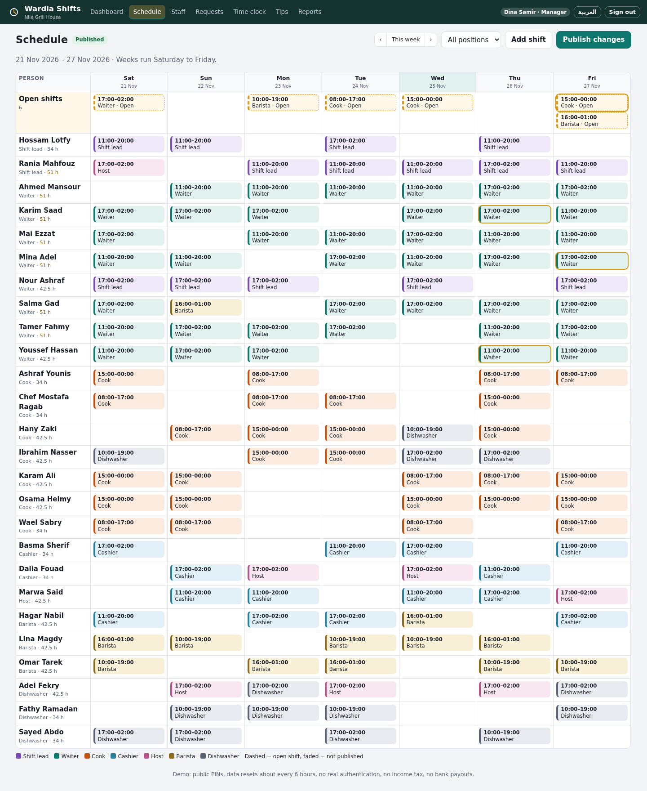
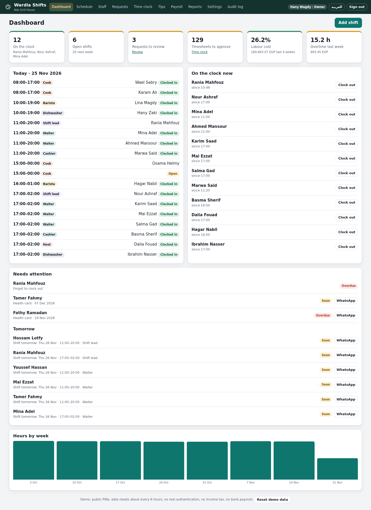
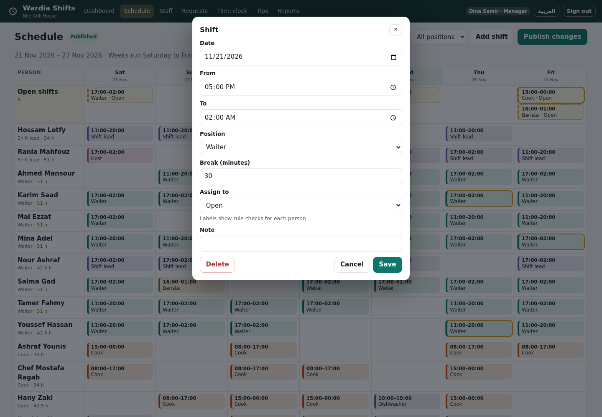
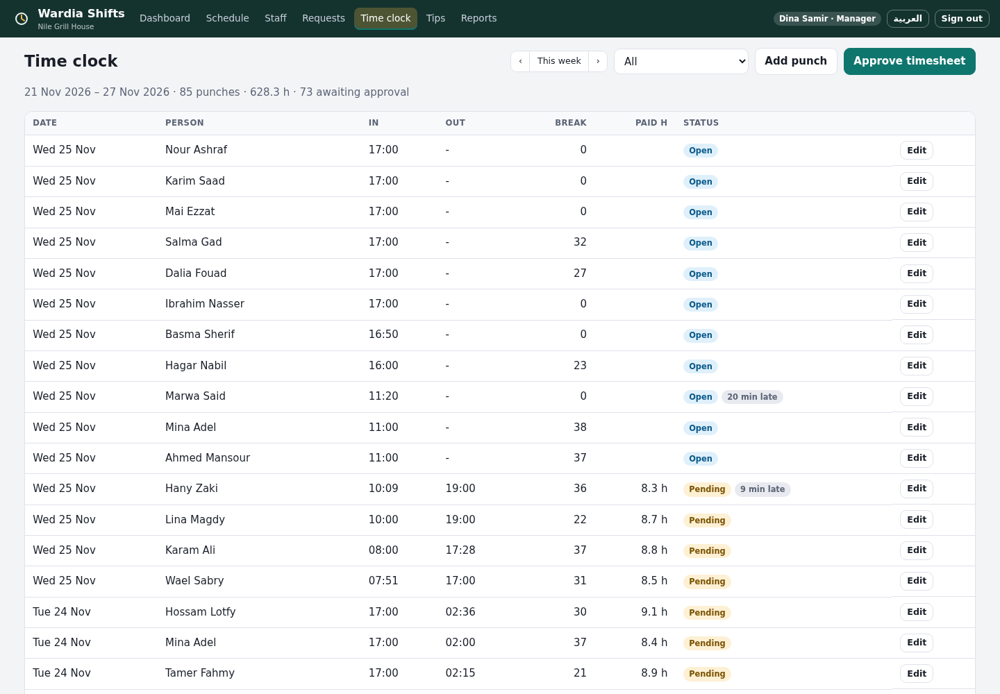
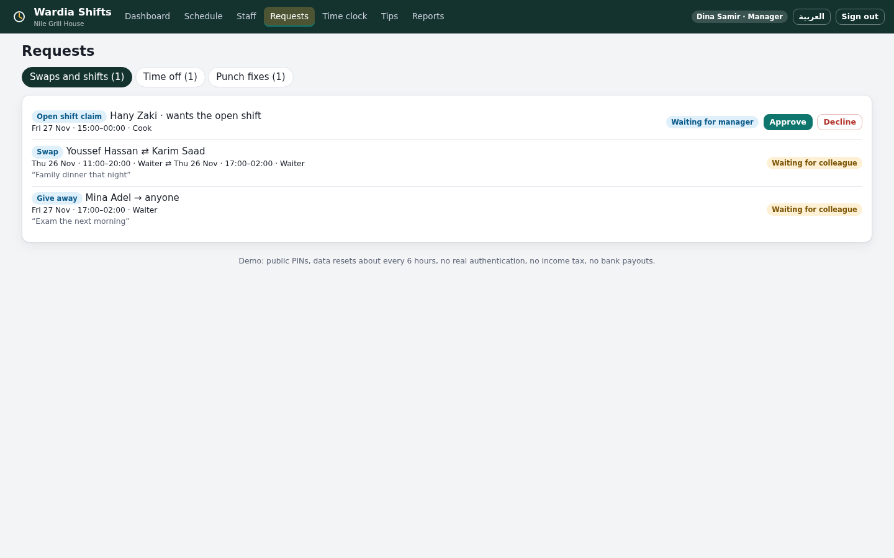
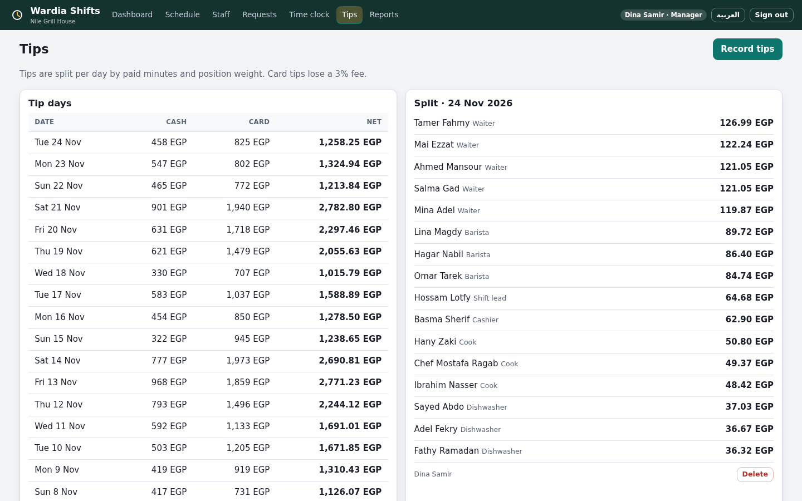
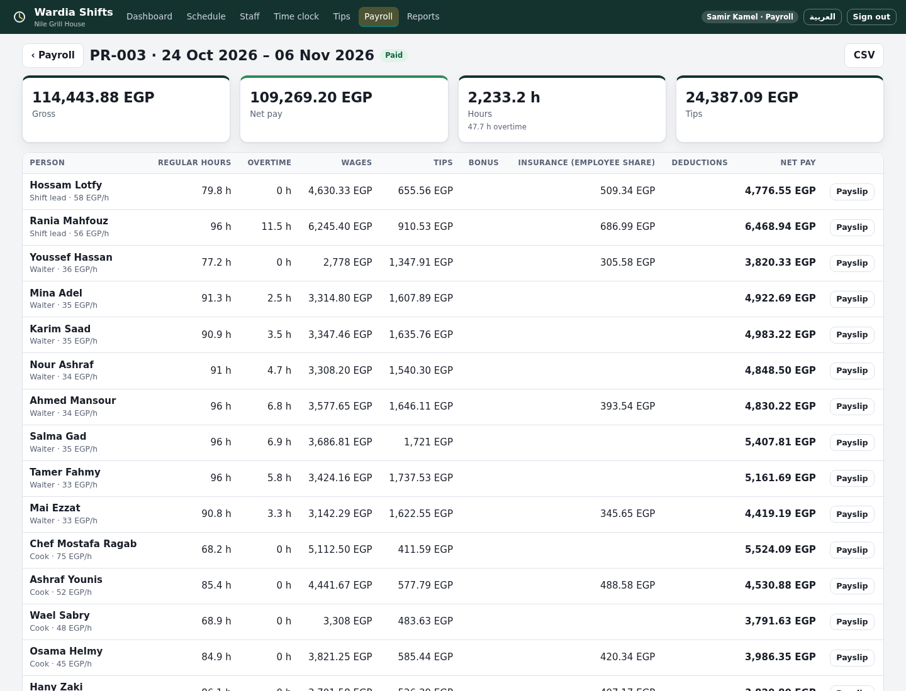
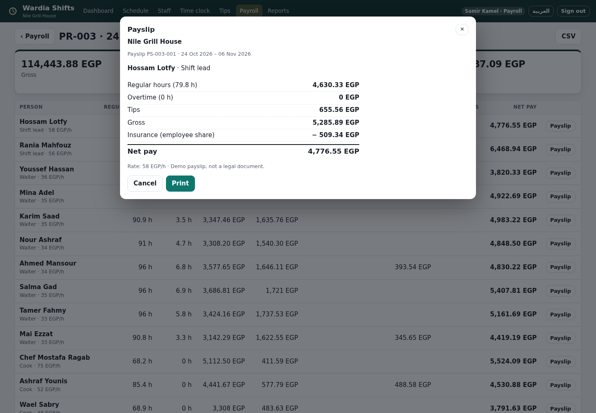
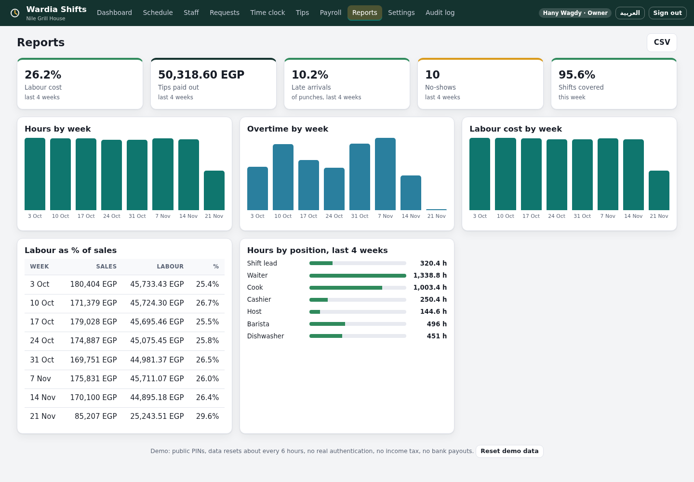

# Wardia Shifts (وردية): restaurant staff scheduling and payroll

A bilingual (Arabic RTL / English) system for a restaurant: weekly shift schedule, availability, shift swaps, time clock with breaks, overtime, tip pooling, payroll runs and payslips.

**Live demo:** https://wardia-shifts.vercel.app
**Product direction, scope and delivery:** Nada Gamal.



## Try it

Open the demo and sign in with a PIN (the language button switches Arabic / English):

| Role | PIN |
| --- | --- |
| Owner (Hany Wagdy) | 1111 |
| Restaurant manager (Dina Samir) | 2222 |
| Payroll accountant (Samir Kamel) | 3333 |
| Staff portal (Youssef Hassan, waiter) | 4444 |

The demo company, Nile Grill House, has 26 employees in 7 positions, about 8 weeks of schedule and punches, three paid payroll runs, pending swaps, time off and a punch correction, open shifts, a forgotten clock-out and expiring health cards. The history is generated by running the same rules the app uses.

## What it does

- **Schedule.** Saturday to Friday week grid by person, with open shifts. Each candidate is labelled with rule checks (inactive, position, time off, availability, overlap, 9h rest, 12h day, weekly cap). Publish, copy last week.
- **Availability and time off.** Staff set any time, day off or a window per weekday and request time off. Managers approve or decline.
- **Swaps.** Give away, direct swap or claim an open shift. A colleague accepts first, then the manager approves. Rules are re-checked on approval.
- **Time clock.** Clock in, breaks, clock out, lateness, an automatic break when none is taken, forgotten clock-outs, manager add, edit and void with a reason, correction requests, timesheet approval.
- **Overtime.** Paid hours above 48 a week are paid at 135%.
- **Tips.** Cash and card tips per day. Card tips lose a 3% fee. The pool is split by paid minutes times a position weight, with largest-remainder rounding so every piaster is allocated.
- **Payroll.** Runs cover 1 or 2 whole weeks. A draft is recomputed live. The owner approves, which snapshots the lines and locks punches and tips. Mark paid (cash, bank or wallet, recorded only), reopen with a reason, bonuses and deductions, 11% insurance for insured staff, payslips, CSV.
- **Reports.** Hours, overtime, labour cost and labour % of sales, lateness, no-shows, coverage, hours by position.
- **Reminders.** Tomorrow's shifts, forgotten clock-outs and health cards, with a WhatsApp link that has the message filled in.
- **Roles.** The owner sees everything including settings and the audit log. The manager runs scheduling and the clock but sees no pay rates. Payroll sees pay and runs. Staff see their own schedule, requests, clock and payslips only (enforced in the API, not only hidden in the UI).

Money is stored as integer piasters. All rules live in `public/logic.js` and are shared by the browser and the API.

## Screenshots

| | |
| --- | --- |
|  |  |
|  |  |
|  |  |
|  |  |

Arabic schedule: `docs/schedule-ar.png`. Arabic payroll: `docs/payroll-ar.png`. Staff portal on a phone: `docs/staff-home-ar-mobile.png`, `docs/staff-schedule-mobile.png`.

## Honest limits

This is a working demo, not a production system.

- The PINs are public and there is no real authentication or per-company accounts.
- State is held in server memory only. It resets about every 6 hours and whenever the serverless instance restarts.
- The time clock is trusted self-service. There is no biometric, GPS or device check.
- The overtime rate, 11% insurance share and card tip fee are demo settings, not legal or payroll advice. There is no income tax and no social insurance filing.
- Payment is only recorded. There is no bank or e-wallet payout. Reminders open a WhatsApp link, nothing is sent automatically.
- Hourly staff only. No salaried staff, no multi-branch.
- Names, phones and amounts are invented. One restaurant, EGP, Cairo time.

## Tests

- `npm test`: unit tests for the rules (rest, caps, overtime, tips rounding, payroll lock, privacy).
- `./run-local.sh node e2e/smoke.mjs`: opens every page for every role in both languages and fails on script errors or `undefined`/`NaN` text.
- `node e2e/smoke.mjs https://wardia-shifts.vercel.app` runs the same against the live demo. `node e2e/shots.mjs` regenerates the screenshots.

## Structure

```
public/        index.html, app.js (UI), logic.js (rules), i18n.js (EN/AR), style.css
api/data.js    one serverless endpoint, role checks and in-memory state
test/          unit tests
e2e/           browser smoke and screenshot scripts
```
